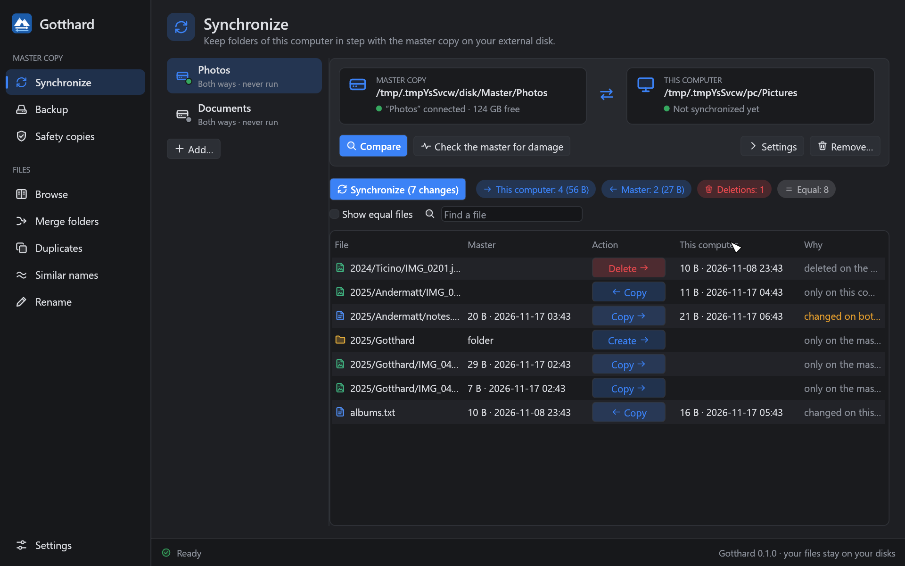
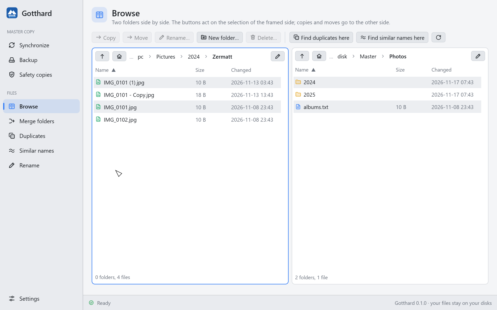

# Gotthard

File sync and file management around a **master copy**, without a cloud. One
native app for Windows 11 that keeps the folders of your desktop and your
laptop in step with a master on an external disk, backs folders up, merges
folder trees, finds duplicates and similar names, and renames files in bulk.

Written in Rust (egui on wgpu), like [DbCraft](https://github.com/ortic/dbcraft).
Nothing is sent anywhere: no account, no server, no telemetry.



## What it does

**Synchronize** — a folder on the external disk is the master; every computer
has its own folder that belongs to it.
- Three directions: both ways, master → computer (mirror), computer → master
  (collect: adds and updates, never deletes).
- **Compare first**: every run starts with a list of what would be copied
  and deleted, file by file. Nothing changes before you start it; when
  synchronizing both ways you can turn any line around or leave it out.
- Both-ways synchronization remembers what both sides looked like after the
  last run. That tells a file deleted here from a file created there, and a
  change on one side from a change on both. Files changed on both sides are
  conflicts that you decide (or the master wins, or the newer file wins).
- The master is recognized by a marker in it, not by its path. A disk that
  got another drive letter is found again; another disk at the old letter
  is refused.

**Backup** — an exact copy of a folder on another disk, in plain files you
can open with Explorer. What a run replaces or removes is kept (see below).

**Check for damage** — records a hash of every file and, at the next check,
finds files whose content changed although their size and time didn't: what
a failing disk does silently.

**Browse** — two folders side by side: copy, move, rename, delete, new
folder, and send a folder or a selection to the other tools.



**Merge folders** — brings several folder trees together in one. Files with
the same content are taken once; for different files with the same path you
choose: keep both, keep the newer, keep the target's, replace.

**Duplicates** — files with exactly the same content, whatever their names
(size, then the first 64 KB, then the whole content, by BLAKE3). Mark all
but the oldest, the newest, the one in the first folder or the shortest
path; the last copy of a file always stays.

**Similar names** — copies and versions that aren't identical:
`Report.docx`, `Report (1).docx`, `Report - Copy.docx`,
`report_final_v2.docx`. Numbered series (`IMG_0012`, `IMG_0013`) aren't
taken for versions.

**Rename** — many files in one go by steps: replace text (also regular
expressions), insert, remove, change case, number, add the file's date,
tidy up copy markers, change the extension. Every new name is shown first,
with what stands in its way (a name Windows refuses, two files getting one
name, a name that's taken). The last rename can be undone.

## Safe by construction

- **Copies are verified**: a copy is written beside its target, read back
  and compared with the original, and only then renamed into place. A copy
  that's interrupted leaves the target as it was.
- **Nothing is lost on purpose**: what a synchronization, backup, merge or
  deletion replaces or removes goes to the folder's **safety copies**
  (`.gotthard\versions\<time of the run>\`), from where the *Safety copies*
  view restores it. The Recycle Bin and deleting for good are settings.
- **A missing disk isn't an empty folder**: a folder that can't be read is
  an error, not a reason to delete its counterpart. A run that would delete
  most of a side asks again.
- **Files that changed since the comparison are skipped**, not overwritten.
- A file moved to another folder is deleted only after its copy is verified.
- Links and junctions are left alone.

## Getting started

1. On the external disk, create the folder for the master, e.g.
   `E:\Master\Photos` (it may already hold your files).
2. In Gotthard: *Synchronize → Add…*, choose it as the master folder and
   click *Make it the master*. Choose this computer's folder.
3. *Compare*, look at the list, *Synchronize*.
4. On the other computer, add the same master folder (it's recognized) and
   that computer's folder.

## Building

```sh
cargo run -p gotthard-app                    # debug build
cargo run --profile fast -p gotthard-app     # optimized, quick to rebuild
cargo build --release -p gotthard-app        # target/release/gotthard(.exe)
```

A Windows build from Linux: `cargo zigbuild --release --target
x86_64-pc-windows-gnu -p gotthard-app` (the exe's icon and version are
compiled with `zig rc`, which zig brings along). Installers (NSIS, MSI) are made with
[cargo-packager](https://github.com/crabnebula-dev/cargo-packager) on
Windows: `cargo packager --release -p gotthard-app`.

## Tests

```sh
cargo test --workspace
```

The file operations (`gotthard-core`) are tested on real temporary folders.
The UI tests (`crates/gotthard-app/src/screenshots.rs`) drive the real app
headless through a synchronization, a backup and the file tools. With
`GOTTHARD_SCREENSHOT_DIR=<folder>` they also render every step into PNGs.

## Layout

| Crate | |
|---|---|
| `gotthard-core` | The file operations, without UI: `scan`, `sync`, `merge`, `dupes`, `similar`, `rename`, `ops`, `vault` (safety copies), `integrity`, `master`, and `fsx` underneath them all. |
| `gotthard-config` | Settings: the synchronized folders, backups and preferences (`%APPDATA%\ortic\Gotthard`). |
| `gotthard-app` | The window. |

## Not there yet

- Runs when you start them: no schedule, no start when the disk is plugged in.
- No synchronization over the network between two computers; the disk
  carries the changes.
- A file renamed or moved on one side is copied anew and its old copy
  removed on the other (to the safety copies).
- Similarity is by name; pictures that look alike aren't compared.
- No encryption of the master or of backups (use BitLocker for the disk).
- English only.

## License

MIT or Apache-2.0, at your option.
